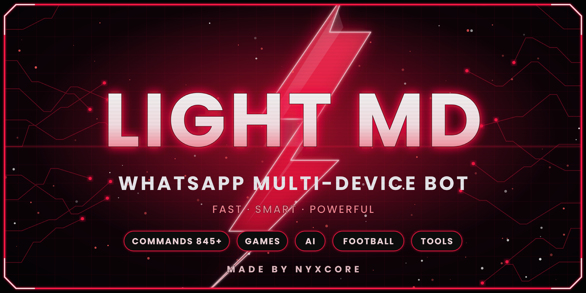

<p align="center">

<!-- OLD IMAGE (to switch back, replace the line above with this one):

Other saved versions: assets/banner-canva.png (Canva design) -->
</p>

<p align="center">
<a href="https://readme-typing-svg.demolab.com"></a>
</p>

<p align="center">
<a href="https://github.com/NYXCORE-X/LIGHT-MD/stargazers"></a>
<a href="https://github.com/NYXCORE-X/LIGHT-MD/forks"></a>


<a href="https://www.npmjs.com/package/@nyxcore/nyxcoresocket"></a>
</p>

<p align="center">
<a href="#-features">Features</a> •
<a href="#-quick-start">Quick start</a> •
<a href="#%EF%B8%8F-pairing-sites">Pair</a> •
<a href="#%EF%B8%8F-deploy-your-bot">Deploy</a> •
<a href="#-deploy-on-github-codespaces">GitHub</a> •
<a href="#-deploy-on-termux-android">Termux</a> •
<a href="#-settings">Settings</a> •
<a href="#-faq">FAQ</a> •
<a href="#-support--community">Support</a>
</p>

<p align="center">
<a href="https://github.com/NYXCORE-X/LIGHT-MD/forks"></a>
<a href="https://github.com/NYXCORE-X/LIGHT-MD/stargazers"></a>
<a href="https://github.com/NYXCORE-X/LIGHT-MD/archive/refs/heads/main.zip"></a>
</p>

---

## ⚡ Features

| | |
|---|---|
| 🎮 **Games & fun** | quickdraw, scramble, trivia, polls, Tic-Tac-Toe (vs players or the bot), horse races, RPG and more |
| 🤖 **AI tools** | ChatGPT, Claude, Gemini style chat, image & text generators, **`promptmaker`** and **`imageprompt`** for writing prompts |
| ⚽ **Football** | live scores, league tables, fixtures and results with tap-to-copy buttons (ESPN, no API key) |
| 🛡️ **Group admin** | welcome / goodbye, anti-link, anti-spam, kick / promote / mute, tag-all, polls |
| 🎨 **Media & tools** | stickers, styled **QR codes**, link shortener, bio maker, text-to-speech, downloaders, converters |
| 💰 **Economy** | balance, daily, shop, pets, horse and car markets, leaderboards |
| 📱 **Works on every phone** | one full text menu on Android, a **full menu picture** on iPhone, tap buttons where WhatsApp allows |
| ☁️ **Deploy anywhere** | Render, Railway, Koyeb, Fly.io, Heroku, Replit, Termux, Codespaces, panels and VPS |

> **845+ commands.** Send `menu` to the bot to see all of them.

---

## 🚀 Quick start

1. **⭐ Star & fork** this repository.
2. **📲 Pair** your WhatsApp with one of the [pairing sites](#%EF%B8%8F-pairing-sites) and copy the **session ID** (it starts with `LIGHT-MD:`).
3. **☁️ Deploy** the bot on any [host](#%EF%B8%8F-deploy-your-bot) and set `SESSION_ID`, `OWNER_NUMBER` and `PREFIX`.
4. **✅ Test it:** send `ping`, then `menu`.

---

## 📲 Pairing sites

<p align="center">
<a href="https://nyxcore-x.lovable.app/"></a>
<a href="https://v0-nxycore.vercel.app/"></a>
</p>

---

## ☁️ Deploy your bot

<p align="center"><b>Pick any host. Same three settings everywhere:</b></p>

| Setting | What to put |
|---|---|
| `SESSION_ID` | the full session string from the pairing site (starts with `LIGHT-MD:`) |
| `OWNER_NUMBER` | your number with country code, digits only (no `+`, no spaces), e.g. `2348012345678` |
| `PREFIX` | the command prefix, e.g. `.` (or `none` to type commands without one). On Termux use `BOT_PREFIX` instead |

<p align="center">
<a href="https://render.com/deploy?repo=https://github.com/NYXCORE-X/LIGHT-MD"></a>
</p>

<h3 align="center">☁️ SITES TO HOST THE BOT</h3>

<p align="center">

<a href="https://render.com">

</a>

<a href="https://bot-hosting.net/?aff=NYXCORE">

</a>

<a href="https://fly.io">

</a>

<a href="https://railway.app">

</a>

<a href="https://koyeb.com">

</a>

<a href="https://northflank.com">

</a>

<a href="https://codesandbox.io">

</a>

<a href="https://replit.com">

</a>

<a href="https://rl.katabump.fr/ba6cd5">

</a>

</p>

---

### 🟣 Render / Railway

The Render Blueprint (`render.yaml`) uses the Dockerfile, which installs Python 3 for `youtube-dl-exec`. Railway uses `nixpacks.toml` to install Python 3.11 before `npm install`.

Set `SESSION_ID` to the full session string beginning with `LIGHT-MD:`, `OWNER_NUMBER` to country code plus digits (without `+` or spaces), and `PREFIX` to the desired command prefix. Set `GITHUB_TOKEN` as a secret only if you use the bot's GitHub-backed features. **Never commit session values or tokens to the repository.**

---

## 🐙 Deploy on GitHub (Codespaces)

GitHub Codespaces gives you a ready-made online computer straight from your fork. It is great for **testing, pairing and short runs** (a free monthly allowance applies, and a codespace stops after a period of no activity, so use Render, Railway or a panel for a bot that must stay online 24/7).

**1. Fork the repo**
Open the repo and tap **Fork** (top right) → **Create fork**.

**2. Add your settings as Codespaces secrets**
On GitHub go to **Settings → Codespaces → Secrets → New secret** (your account settings, under *Code, planning, and automation*), and add these three. Under *Repository access* choose your fork.

| Secret name | Value |
|---|---|
| `SESSION_ID` | your `LIGHT-MD:...` session string |
| `OWNER_NUMBER` | e.g. `2348012345678` |
| `PREFIX` | e.g. `.` |

Secrets stay private and are never written into your code.

**3. Open a codespace**
On your fork tap **Code → Codespaces → Create codespace on main**. The included `.devcontainer` sets up Node 22, Python 3 and ffmpeg and runs `npm install` for you. Wait until the terminal is ready.

**4. Start the bot**
```bash
npm start
```
Watch the terminal for `WhatsApp : connected`. Then send `ping` to your bot from WhatsApp.

**No session yet?** Leave `SESSION_ID` empty, run `npm start` and follow the pairing steps shown in the terminal.

**5. Keep it tidy**
- 🛑 To stop: press `Ctrl + C`, then **Stop current codespace** from the Codespaces page so you do not use up your free hours.
- 🔄 To update: open the fork, tap **Sync fork → Update branch**, then in the codespace run `git pull` and `npm install` and start again.
- 🔐 Never paste your session or tokens into files or commits. Use Codespaces secrets only.

---

## 📱 Deploy on Termux (Android)

Run LIGHT MD from your own phone. Great for testing and for people with no hosting money. The bot stops when Termux is closed or the phone sleeps, so use a host above for 24/7.

**1. Install Termux**
Install it from **[F-Droid](https://f-droid.org/packages/com.termux/)** or the [official GitHub releases](https://github.com/termux/termux-app/releases). The Play Store version is outdated and will not work.

**2. Install the tools** (copy each line into Termux)
```bash
pkg update -y && pkg upgrade -y
pkg install -y git nodejs-lts python ffmpeg
```

**3. Get the bot**
```bash
git clone https://github.com/NYXCORE-X/LIGHT-MD
cd LIGHT-MD
npm install
```
`npm install` can take a few minutes on a phone. Wait for it to finish.

**4. Set your settings**
```bash
export SESSION_ID="LIGHT-MD:paste-your-session-here"
export OWNER_NUMBER="2348012345678"
export BOT_PREFIX="."
```
> ⚠️ In Termux use **`BOT_PREFIX`**, not `PREFIX`. Termux already uses `PREFIX` for its own folder.

**5. Start the bot**
```bash
npm start
```
Look for `WhatsApp : connected`, then send `ping` to your bot from another number.
**No session yet?** Skip the `SESSION_ID` line, run `npm start` and follow the pairing steps on the screen.

**6. Keep it running**
```bash
pkg install -y tmux
termux-wake-lock          # stops Android putting Termux to sleep
tmux new -s bot           # then run: npm start
```
Detach with `Ctrl + B`, then `D`. Come back later with `tmux attach -t bot`. In your phone's battery settings, set Termux to **Unrestricted / No battery optimisation**.

**7. Update later**
```bash
cd LIGHT-MD && git pull && npm install && npm start
```
(or just send `update` to the bot.)

> 🔐 Your session is like a password. Never share it or put it on GitHub.

---

## ⚙️ Settings

| Command | What it does |
|---|---|
| `menu` | full command list (picture on iPhone) · `menu 3`, `menu fun` for one category |
| `setmenu 1-6` | choose the menu style |
| `setprefix` | change the command prefix |
| `mode` | public / private bot |
| `update` · `update force` | update the bot from GitHub |

---

## ❓ FAQ

<details>
<summary><b>The bot does not reply</b></summary>

Send `ping` from a different number than the bot's own. Check `OWNER_NUMBER` has no `+` or spaces, that `SESSION_ID` is complete, and look at the logs (`logs 30`).
</details>

<details>
<summary><b>I cannot see the buttons</b></summary>

WhatsApp does not let the bot's own phone tap reply buttons or lists on its own messages, so the bot shows copy buttons or text there. Other people see normal buttons.
</details>

<details>
<summary><b>The menu is cut off on iPhone</b></summary>

iPhone cuts very long text. LIGHT MD sends the full menu as one picture there. Zoom in to read it.
</details>

<details>
<summary><b>How do I update?</b></summary>

Send `update` (or `update force`) to the bot, or sync your fork and redeploy.
</details>

---

## 💬 Support & community

<p align="center">
Need help with <b>LIGHT MD</b>? Reach out through any of the channels below.
</p>

<p align="center">
<a href="https://wa.me/2348133504568"></a>
<a href="https://wa.me/2348150613178"></a>
<a href="https://t.me/NYXCORE_X"></a>
</p>

---

<p align="center">
Made with ❤️ by <b>NYXCORE</b><br>
LIGHT MD © 2026<br><br>
⭐ <b>Don't forget to star the repository</b> ⭐
</p>
